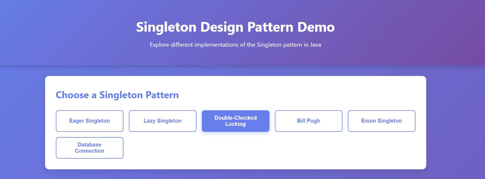

# Singleton Pattern — Java 17 + Spring Boot

This demo compares eager initialization, synchronized lazy initialization,
double-checked locking, the initialization-on-demand holder (Bill Pugh), and
enum singletons. The `/api/singleton/*` endpoints expose their identities.

## Run

Java 17 and Gradle are required. This repository does not currently include
the Gradle wrapper JAR, so use an installed `gradle` executable:

```bash
gradle bootRun
gradle test
```

## Important: database example is a simulation

`DatabaseConnection` stores a URL string and an in-memory connected flag.
It **does not** create a JDBC connection. It now demonstrates safe publication
using `volatile` plus double-checked locking; its state getters and setters
are synchronized. Calling `connect()` changes a flag only.

Do not use one globally shared JDBC `Connection` as a production pattern.
Spring Boot services generally use a managed `DataSource` (connection pool)
with scoped, safely managed connections.

## Pattern comparison

| Version | Initialization | Thread safety |
| --- | --- | --- |
| Eager | Class initialization | JVM class initialization |
| Lazy | First call | Synchronized accessor |
| Double-checked | First call | `volatile` + synchronized |
| Bill Pugh | Inner holder initialized on first use | JVM class initialization |
| Enum | Enum initialization | JVM enum/class initialization |

A Spring singleton-scoped bean is **one instance per application context**
by default, not a JVM-global single instance. A singleton service also does
not guarantee that its mutable fields are thread-safe.


